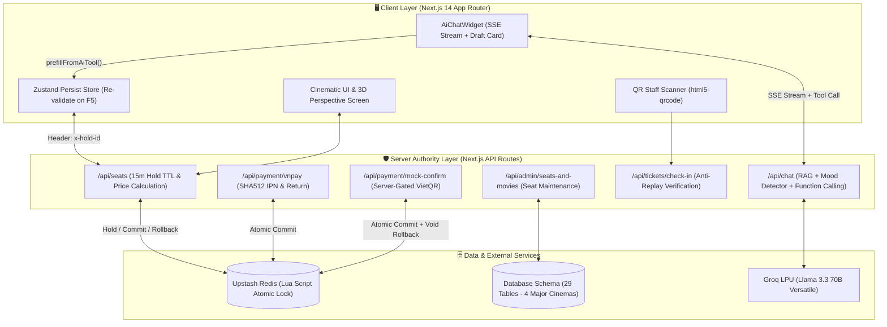

# 🎬 CineMax AI — Nền Tảng Đặt Vé Rạp Điện Ảnh & AI Agent Thế Hệ Mới


**CineMax AI** là hệ thống khám phá phim ảnh và đặt vé rạp chiếu phim toàn diện (End-to-End Cinema Booking Platform), kết hợp giữa **giao diện điện ảnh chuẩn Netflix/IMDb**, **kiến trúc giữ ghế nguyên tử chống trùng lặp trên Redis**, **hệ thống thanh toán kép (VNPay Sandbox & VietQR)** và **Trợ lý AI Agent siêu tốc (~500 tokens/s) chạy trên chip Groq LPU**.

---

## 🏗️ Sơ Đồ Kiến Trúc Hệ Thống (System Architecture)

Hệ thống được thiết kế theo triết lý **Strict Server Authority** — mọi nghiệp vụ nhạy cảm (giữ ghế, tính giá vé, xác thực thanh toán và phát hành/soát vé QR) đều do Server quyết định, chống tuyệt đối việc can thiệp dữ liệu từ phía Client.



---

## 🌟 6 Điểm Nhấn Công Nghệ Cốt Lõi

### 1. 🤖 Groq AI Agent: RAG + Mood Detector + Function Calling (`/api/chat`)
* **Tốc độ phản hồi tức thì (< 200ms):** Sử dụng `llama-3.3-70b-versatile` trên hạ tầng Groq LPU với tốc độ sinh văn bản 300–500 tokens/giây qua cơ chế **Server-Sent Events (SSE)**.
* **Nhận diện cảm xúc & Tri thức phim (518+ dòng xử lý RAG & Mood Detector):** Phân tích tâm trạng người dùng để tư vấn bộ phim phù hợp nhất và gợi ý vị trí ghế ngồi tối ưu trong rạp.
* **Agentic Booking Draft (`prepare_booking_draft`):** Khi khách chat *"Đặt cho mình 2 ghế VIP xem Dune tối nay kèm 1 bắp ngọt"*, AI tự động trích xuất tham số, hiển thị **Widget Đặt Vé Nhanh** ngay trong khung chat và điền sẵn vào `BookingModal` (vẫn tuân thủ nghiêm ngặt bước giữ ghế Redis và thanh toán).

### 2. 🔒 Cơ Chế Giữ Ghế Nguyên Tử & Phục Hồi Giỏ Vé Sau Khi F5
* **Khóa ghế nguyên tử (Atomic Lua Script trên Redis):** Khi khách chọn ghế (`standard`, `vip`, `couple`), `seatStore.ts` cấp phát token định danh `holdId` với thời gian sống **TTL 15 phút**, ngăn chặn triệt để lỗi *Race Condition* khi 2 người cùng bấm 1 ghế.
* **Zustand Persist & Server Re-validation (`useBookingStore.ts`):** Nếu khách lỡ tay bấm F5 (Reload) hoặc rớt mạng tạm thời khi đang chọn bắp nước, giỏ vé tự động được khôi phục từ `localStorage` và gửi `header: { 'x-hold-id': holdId }` lên Server để đối chiếu. Nếu phiên giữ ghế trên Redis đã hết hạn, giỏ hàng tự động dọn sạch để chống lỗi "ghế ma".

### 3. 💳 Thanh Toán Kép: Cổng VNPay Sandbox & Chuyển Khoản VietQR
* **Server-side Price Authority (`calculatePrice()`):** Giá vé và combo bắp nước được tính toán hoàn toàn ở Backend, từ chối mọi yêu cầu chỉnh sửa giá từ Client.
* **Cổng VNPay chuẩn SHA512 (`/api/payment/vnpay/*`):** Hỗ trợ đầy đủ luồng tạo URL thanh toán (`create-url`), đối soát ngầm (`ipn`) và trang kết quả (`return`).
* **VietQR Động & Nút Demo Có Gác Cổng (`/api/payment/mock-confirm`):** Tự động sinh mã QR ngân hàng kèm số tiền và nội dung chuyển khoản chuẩn xác. Tích hợp âm thanh máy POS **"Ting-Ting!"** bằng **Web Audio API** thuần (sóng sine kép `987.77 Hz` & `1318.51 Hz` — không phụ thuộc file MP3 ngoài) chỉ phát sau khi Server đã commit ghế trên Redis và nâng trạng thái vé từ `pending` sang `valid`.

### 4. 👓 Mô Phỏng Góc Nhìn 3D Thời Gian Thực Từ Ghế Ngồi (`screen3D.ts` & `ViewFromSeatModal.tsx`)
* **Góc nhìn chuẩn điện ảnh SMPTE 40° & Dolby Atmos:** Xem trước góc nhìn thực tế từ từng vị trí ghế trong phòng chiếu.
* **Real-time 3D Perspective Screen:** Khi khách click chọn ghế từ hàng `A` (sát màn hình) đến hàng `E, F, G` (trung tâm VIP) hay hàng `K` (ghế đôi Sweetbox cuối rạp), thanh màn hình cong tự động nội suy góc nghiêng `perspective`, `rotateX`, `rotateY` và `scale` theo đúng tọa độ ghế.

### 5. 🎟️ Hệ Thống Vé Điện Tử QR & Máy Quét Soát Vé Chống Gian Lận (`/scanner`)
* **Xuất E-Ticket tự động:** Vé hợp lệ (`valid`) đi kèm mã QR định danh duy nhất.
* **Phân hệ Soát vé Nhân viên (`/scanner` & `/api/tickets/check-in`):** Sử dụng camera trực tiếp (`html5-qrcode`) hoặc nhập mã tay kèm hiệu ứng âm thanh bíp. Hệ thống chặn tuyệt đối vé giả mạo và báo lỗi ngay nếu một mã vé bị quét lại lần thứ 2 (chống dùng 1 ảnh chụp màn hình cho nhiều người vào rạp).

### 6. 🛠️ Phân Hệ Quản Trị Rạp, Đánh Giá Phim & CSDL 29 Bảng Thực Tiễn
* **Quản trị phòng chiếu (`/api/admin/seats-and-movies`):** Cho phép Admin khóa/mở khóa ghế bảo trì, chuyển đổi linh hoạt hạng ghế và quản lý danh mục phim.
* **Hệ thống Đánh giá & Bình luận (`/api/reviews`):** Quản lý đánh giá của khán giả theo từng bộ phim.
* **Thiết kế CSDL 29 Bảng (`database_schema.dbml`, `prisma/schema.prisma`):** Được xây dựng từ kết quả khảo sát nghiệp vụ thực tế tại 4 hệ thống rạp lớn (CGV, Lotte Cinema, Galaxy Cinema, Beta Cinemas).

---

## 📂 Cấu Trúc Các Phân Hệ Chính (Routes & Modules)

| Route / Module | Mô tả chức năng |
| :--- | :--- |
| `/` | Trang chủ khám phá phim (Hero Banner, Trending, Now Playing, Upcoming), tìm kiếm tức thì & AI Chat. |
| `/scanner` & `/staff/scanner` | Giao diện máy quét mã QR soát vé tại quầy dành cho nhân viên rạp. |
| `/api/chat` | Endpoint AI Streaming kết hợp RAG, Mood Detector và Groq Function Calling (`prepare_booking_draft`). |
| `/api/seats` | Quản lý trạng thái sơ đồ ghế, cấp phát `holdId` (15 phút) và xác thực lại phiên giữ ghế qua `x-hold-id`. |
| `/api/booking` | Khởi tạo đơn đặt vé ở trạng thái `pending` với giá tính từ Server (`calculatePrice`). |
| `/api/payment/vnpay/*` | Bộ 3 endpoints xử lý thanh toán VNPay (`create-url`, `ipn`, `return`) với chữ ký băm SHA512. |
| `/api/payment/mock-confirm` | Endpoint gác cổng xác nhận thanh toán Demo (chỉ mở khi cho phép), thực thi commit ghế Redis & rollback an toàn. |
| `/api/tickets/check-in` | API kiểm tra tính hợp lệ của E-Ticket và đánh dấu trạng thái đã qua cửa soát vé. |
| `/api/admin/seats-and-movies` | API phân hệ Admin quản lý khóa ghế hỏng/bảo trì, đổi hạng ghế và cập nhật phim. |
| `/api/reviews` | API phân hệ bình luận và chấm điểm phim của người dùng. |

---

## 🚀 Hướng Dẫn Cài Đặt & Khởi Chạy

### 1. Cài đặt thư viện
```bash
npm install
```

### 2. Cấu hình biến môi trường (`.env.local`)
Hệ thống hỗ trợ chế độ **Smart Mock Fallback** (chạy mượt ngay cả khi chưa điền đầy đủ khóa ngoại vi). Để kích hoạt toàn bộ sức mạnh của AI, TMDB, Redis và Cổng thanh toán, hãy tạo file `.env.local`:

```env
# 1. AI & Dữ liệu Phim
GROQ_API_KEY=gsk_your_groq_key_here
TMDB_API_KEY=your_tmdb_api_key_here

# 2. Upstash Redis (Giữ ghế nguyên tử - tùy chọn fallback in-memory khi dev)
UPSTASH_REDIS_REST_URL=your_upstash_url
UPSTASH_REDIS_REST_TOKEN=your_upstash_token

# 3. Cấu hình Cổng VNPay Sandbox
VNP_TMNCODE=your_vnpay_tmncode
VNP_HASHSECRET=your_vnpay_hashsecret
VNP_URL=https://sandbox.vnpayment.vn/paymentv2/vpcpay.html
VNP_RETURN_URL=http://localhost:3000/api/payment/vnpay/return

# 4. Cấu hình VietQR & Cờ bảo mật thanh toán Demo
VIETQR_BANK_ID=MB
VIETQR_ACCOUNT_NO=0987654321
VIETQR_ACCOUNT_NAME="RAP PHIM CINEMAX AI"
ALLOW_MOCK_PAYMENT=true
```

### 3. Khởi chạy máy chủ phát triển
```bash
npm run dev
```
Truy cập ứng dụng tại: [http://localhost:3000](http://localhost:3000)

---

## 🧪 Kiểm Thử Tự Động & Chất Lượng Mã Nguồn (Testing & QA)

Dự án đi kèm bộ kiểm thử các phân hệ và kiểm thử đầu-cuối (End-to-End) với **Playwright**:

```bash
# Kiểm tra kiểu dữ liệu TypeScript toàn dự án
npx tsc --noEmit

# Chạy bộ test tích hợp các module nghiệp vụ
npm run test:all

# Chạy kiểm thử tự động trên trình duyệt với Playwright E2E
npm run test:e2e
npm run test:e2e:ui
```

---

## 🛠️ Công Nghệ Sử Dụng (Tech Stack)
* **Core Framework**: Next.js 14 (App Router), React 18, TypeScript 5.6
* **State Management**: Zustand (`zustand/persist` đồng bộ Redis TTL)
* **Styling & Animation**: Tailwind CSS, Lucide Icons, CSS 3D Perspective Transform, Glassmorphism
* **AI Engine**: Groq SDK (`llama-3.3-70b-versatile` với SSE Streaming, RAG & Tool Calling)
* **Data & Caching**: Upstash Redis (Lua Atomic Lock), Prisma / DBML Schema (29 Tables)
* **Payment & Tickets**: VNPay SHA512, VietQR API, Web Audio API Synthesizer, `qrcode` & `html5-qrcode`
* **Testing**: Playwright E2E (`@playwright/test`), TSX Module Runner
